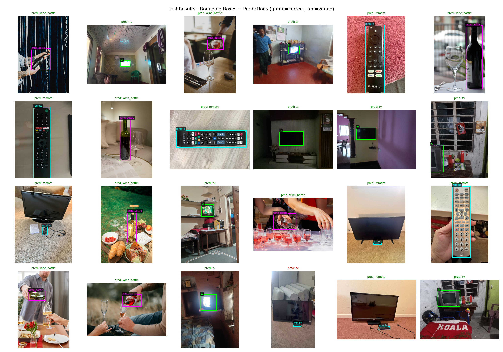
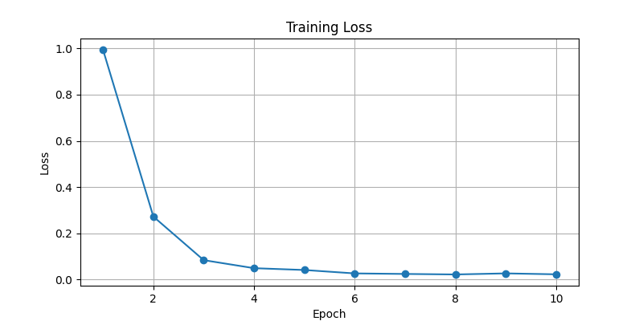

# rcnn-multiclass

An object detector trained on my own photos. It looks at an image and says whether it shows a **TV**, a **remote** or a **wine bottle**, and where the object is.

The whole pipeline is here, from taking the pictures to testing the model: rename the photos, draw boxes on them, split them, train on Kaggle, and check the results.

<p align="center">
  
</p>

## How it works

The model is a simplified R-CNN with a VGG16 backbone pretrained on ImageNet. There is one object per image.

1. **Resize** the image to 224×224 and normalize it the way VGG16 expects.
2. **Extract features** with VGG16's convolutional layers. The first 10 layers are frozen, the rest keep learning.
3. **Two heads** read the same features:
   - the **class head** picks one of 4 classes: tv, remote, wine_bottle, or background;
   - the **box head** predicts the 4 corners of the bounding box.
4. **Loss** = classification loss (cross-entropy) + box loss (smooth L1).

Training: 10 epochs, batch size 2, SGD with learning rate 0.001.

<p align="center">
  
</p>

The loss drops from about 1.0 to 0.05 in the first 4 epochs, then stays around 0.02.

## Results

**23 of 24 test images classified correctly (about 96%).**

In the picture above, the title over each image is the model's prediction (green if right, red if wrong), and the box is the true box from the annotations.

The one mistake is a photo of a remote with a TV behind it, and the model said "tv". Several remote photos have a TV in the frame too, but the model can give only one answer per image, and only the remote is labeled. A detector that finds several objects per image would handle this better.

## Dataset

120 photos, 40 per class, boxes drawn in LabelMe. The split is 96 for training and 24 for testing, balanced by class. The images are on Kaggle (`tylerde/rcnn-multiclass-dataset`). Only the box annotations are in this repo.

How the dataset was built:

| Step | Script | What it does |
|---|---|---|
| 1 | `rename_images.py` | renames photos to `tv_01.jpg`, `remote_01.jpg`, ... |
| 2 | LabelMe | draw a box around the object, saved as JSON |
| 3 | `json_to_csv.py` | collects all boxes into `annotations.csv` |
| 4 | `split_dataset.py` | 80/20 split into `train.csv`, `test.csv` and `dataset/train`, `dataset/test` |

## Requirements

- **Python 3** and the packages in `requirements.txt` (PyTorch, torchvision, pandas, matplotlib, LabelMe)
- `split_dataset.py` also needs `scikit-learn`
- A GPU helps. Training was done on Kaggle.

## Run

On Kaggle, add the dataset to a notebook and run:

```
python rcnn_multi.py
python visualize.py
```

`rcnn_multi.py` trains the model, prints accuracy per class, saves `screenshots/training_loss.png` and the weights to `models/rcnn_model.pth`.

`visualize.py` loads the weights and saves `screenshots/all_predictions.png`: every test image with its true box, and the prediction in green if correct, red if wrong.
To run locally instead, change `DATA_DIR` at the top of both scripts to the folder with `train.csv`, `test.csv` and `dataset/`.

## Code

```
rcnn_multi.py       dataset loader, model, training, testing
visualize.py        draws test images with boxes and predictions
rename_images.py    step 1 of dataset prep
json_to_csv.py      step 3: LabelMe JSON to CSV
split_dataset.py    step 4: train/test split
annotations.csv     all 120 boxes
train.csv, test.csv the split
models/             trained weights (not in git)
screenshots/        loss plot and predictions
```
